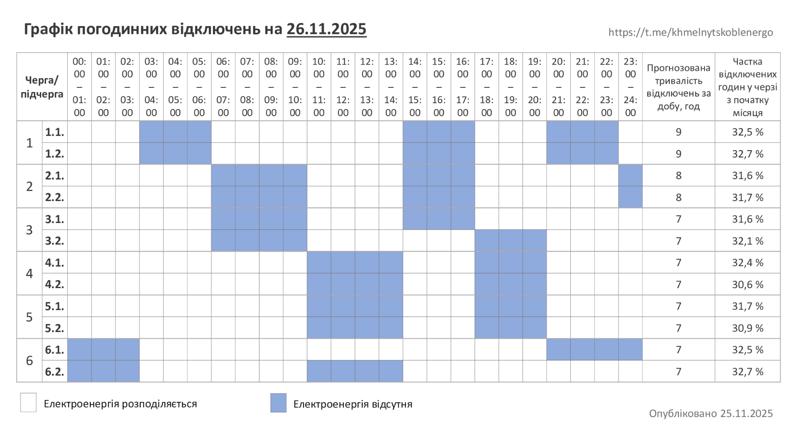

# ⚡ HoeShutdownNotifier

[](https://github.com/DraKuLa21-a42/HoeShutdownNotifier_v2/actions/workflows/tests.yml)


**Telegram-бот, який стежить за погодинними відключеннями електроенергії на сайті
[Хмельницькобленерго](https://hoe.com.ua) і пише вам, щойно щось змінилось.**

Додайте свою адресу в боті (населений пункт → вулиця → будинок) — і більше нічого перевіряти на сайті не треба.
Сповіщення можна отримувати в особистих повідомленнях, у групі або в **каналі**.

> ℹ️ Неофіційний проєкт, не пов'язаний з Хмельницькобленерго. Дані беруться з публічних запитів сайту hoe.com.ua
> і можуть відставати від офіційних — для важливих рішень звіряйтесь із сайтом.

## Можливості

- 🏠 **Багато адрес.** Десятки адрес у різних чатах; на кожну унікальну адресу — один запит до сайту, скільки б підписників вона не мала.
- 🤖 **Керування з Telegram.** `/add` веде по кроках і звіряє будинок зі списком сайту (латинська `A` = кирилична `А`). Не потрібно шукати ID чи правити файли.
- 📣 **Канали й групи.** `--to=@my_channel` — і сповіщення йдуть у канал; бот сам перевіряє права.
- 🔔 **Тільки зміни.** Нове відключення, зміна графіка, «відключень немає» — без повторів кожні 15 хвилин.
- 📈 **Графік ГПВ: картинка або текст.** Сайт публікує графік то зображенням, то простим текстом — бот розуміє обидва формати і надсилає, щойно він змінився.
- 🛠 **Панель адміністратора.** `/admin`: статистика, ручний запуск опитування, показ і розсилка графіка кнопками.
- 🔕 **Налаштування кнопками.** Звук, графік, відключення — окремо для кожної адреси (`/list`).
- 🛡 **Надійність.** Ретраї, перевірка змін верстки, захист сайту від частих запитів, автоочищення підписок мертвих чатів.
- 🧰 **Просте розгортання.** Один systemd-сервіс, SQLite, жодних зовнішніх залежностей. Slack — опційно.

## Як це виглядає

Сповіщення (приклад):

```
Змінились погодинні відключення!
📍 Давидківці, вул. Подільська, 1

Вид робіт: Планові
Тип відключення: Відключення
Черга ГПВ: 2.1
Початок: 26.11.2025 14:00
Кінець: 26.11.2025 18:00
```

Графік у вигляді тексту (коли сайт публікує його не картинкою):

```
Графік погодинних відключень

За розпорядженням НЕК «Укренерго» 07 листопада на Хмельниччині будуть застосовані графіки погодинних відключень (ГПВ):

Підчерга 1.1 – 00:00-04:00; 09:00-13:00; 18:00-21:00.
Підчерга 1.2 – 00:00-04:00; 09:00-13:00; 18:00-21:00.
...
```

Графік у вигляді картинки (його публікує Хмельницькобленерго):

<p align="center"></p>

## Швидкий старт

Потрібні Python 3.10+ і токен бота від [@BotFather](https://t.me/BotFather).

```bash
# окремий користувач без домашньої теки та входу в систему
sudo useradd --system --no-create-home --shell /usr/sbin/nologin hoe

sudo git clone https://github.com/DraKuLa21-a42/HoeShutdownNotifier_v2.git /opt/HoeShutdownNotifier
sudo chown -R hoe:hoe /opt/HoeShutdownNotifier
cd /opt/HoeShutdownNotifier

sudo -u hoe python3 -m venv venv
sudo -u hoe venv/bin/pip install --no-cache-dir -r requirements.txt
sudo -u hoe cp .env.example .env
sudo -u hoe nano .env            # BOT_TOKEN і ADMIN_IDS — обов'язково
sudo -u hoe mkdir -p data
sudo chmod 600 .env

sudo cp deploy/hoe-notifier.service /etc/systemd/system/
sudo systemctl daemon-reload
sudo systemctl enable --now hoe-notifier
journalctl -u hoe-notifier -f
```

Відкрийте бота в Telegram і надішліть `/add`.

**Оновлення:**

```bash
cd /opt/HoeShutdownNotifier
sudo -u hoe git pull
sudo -u hoe venv/bin/pip install --no-cache-dir -r requirements.txt
sudo systemctl restart hoe-notifier
```

**Резервна копія.** Усі підписки та стан лежать в одному файлі `data/hoe.sqlite3`. Для узгодженої копії під час роботи
сервісу: `sqlite3 data/hoe.sqlite3 ".backup '/шлях/hoe-backup.sqlite3'"`.

## Команди бота

| Команда | Що робить |
|---|---|
| `/add [населений пункт]` | Діалог: населений пункт → вулиця → будинок. `/add Давидківці` одразу шукає цей пункт; у приватному чаті є кнопка з останнім обраним |
| `/add … --queue=1.1` | Те саме, з одразу вказаною чергою |
| `/add … --to=<ID або @канал>` | Те саме, але сповіщення йтимуть у канал чи групу ([докладніше](#сповіщення-в-канал-або-групу)) |
| `/add … --slack=<ID або #канал>` | Сповіщення в канал Slack від вашого Slack-бота ([докладніше](#slack)) |
| `/slack` | Підключити власного Slack-бота, переглянути й видалити ботів ([докладніше](#slack)) |
| `/list` | Мої адреси; кнопки: відключення ✅/⬜, графік ✅/⬜, звук 🔔/🔕, видалити 🗑 |
| `/check` | Перевірити всі мої адреси зараз |
| `/graph [all]` | Показати актуальний графік — картинку та/або текст. Якщо вказано чергу — текст лише для неї, `all` — повністю |
| `/admin` | Лише для `ADMIN_IDS`, лише в приваті: панель із кнопками ([докладніше](#панель-адміністратора)) |
| `/subs [сторінка]` | Лише для адмінів, в приваті: усі підписки всіх чатів (по 10 на сторінку, кнопки ◀ ▶) |
| `/stats` | Лише для адмінів: чатів, підписок, адрес, час останнього циклу |
| `/cancel` | Скасувати поточний діалог |

У груповому чаті змінювати адреси можуть лише адміністратори групи. Бот працює в групах і з увімкненим privacy mode:
у діалозі `/add` він просить відповідати на його повідомлення.

### Як перевіряється будинок

Бот користується тими самими запитами, що й форма на hoe.com.ua:

| Крок | Запит до сайту |
|---|---|
| Населений пункт | `GET /settlements/?term=…` |
| Вулиця | `GET /streets/{id населеного пункту}?term=…` |
| Будинок | `GET /houses/{streetId}` |
| Відключення | `POST /shutdown-events` (`streetId`, `house`) |

Номер будинку звіряється зі списком сайту: регістр не важливий, латиниця й кирилиця вважаються однаковими, зберігається
написання з сайту. Якщо будинку немає, бот пропонує схожі (`12` → `12А`, `12/1`) або кнопку «Все одно додати».
Якщо пошук на сайті тимчасово недоступний, спробуйте пізніше. Для досвідчених лишилась команда
`/add_id <streetId> <будинок> [назва]` (вона приймає ті самі `--queue`, `--to`, `--slack`), але звичайним користувачам вона не потрібна.

## Графік ГПВ: картинка або текст

На сторінці [погодинних відключень](https://hoe.com.ua/page/pogodinni-vidkljuchennja) Хмельницькобленерго публікує графік
**то картинкою, то простим текстом** (інколи обома способами). Бот підтримує обидва формати:

- Кнопка **«Графік»** в `/list` (або `graphs = true` в `addresses.toml`) вмикає надсилання графіка в будь-якому вигляді.
- Картинка вважається новою, коли змінилась її адреса; текст — коли змінився його вміст (наприклад, зі зміною дати).
  Той самий графік двічі не надсилається.
- Текст надсилається як є, звичайним повідомленням (не блоком коду), тож рядки гарно переносяться на телефоні.
- `/graph` показує те, що на сайті зараз, будь-кому — незалежно від підписки.

## Фільтр за чергою

Кожна адреса може мати **свою підчергу ГПВ** (`1.1` … `6.2`). Тоді бот надсилає лише те, що її стосується:

- **Як вказати:** кнопка «🔢 Черга» в `/list` (і під повідомленням «Додано»), або `--queue=1.1` у `/add`,
  або `queue = "1.1"` в `addresses.toml`. Змінити чи зняти фільтр («Усі черги») можна в будь-який момент.
- **Відключення за адресою:** з відповіді сайту лишаються записи, де `Черга (ГПВ)` збігається з обраною. Черга без
  підчерги (`2`) вважається збігом для `2.1` і `2.2`. Записи **без ГПВ-черги** (наприклад, лише `Черга (ГАВ)`)
  показуються завжди. Повідомлення надходить, лише коли змінилось *відфільтроване* — зміни в чужих чергах не турбують.
  Якщо для вашої черги нічого немає, статус: «Погодинних відключень для черги 1.1 немає!».
- **Текстовий графік:** чат отримує лише рядки `Підчерга …` своїх черг. Якщо в чаті кілька адрес із різними чергами —
  отримає їх об'єднання; якщо хоч одна адреса без черги — повний графік. `/graph all` завжди показує повний.
- Черга зберігається **для кожної адреси окремо**. Картинка-графік не фільтрується (це зображення).
- Існуючі підписки після оновлення працюють як раніше (без фільтра): база мігрує автоматично.

## Slack

Кожен користувач **сам створює свого Slack-бота і підключає його до сервісу прямо в Telegram** — ні `addresses.toml`,
ні токена на сервері не потрібно. Бот користувача пише лише в канали його воркспейсу, куди він сам його запросив,
тому окремих прав на додавання адрес не потрібно.

1. У боті надішліть `/slack` → «➕ Підключити Slack-бота» (інструкція всередині). Коротко: на api.slack.com/apps
   створіть застосунок, у **OAuth & Permissions** додайте права `chat:write` і `files:write` (для пошуку каналів за
   назвою — ще `channels:read`, `groups:read`), натисніть **Install to Workspace** і скопіюйте **Bot User OAuth Token**
   (`xoxb-…`). Або одразу: `/slack xoxb-…`.
2. Надішліть токен боту в **приватному** чаті. Повідомлення з токеном бот одразу видаляє, токен перевіряється
   (`auth.test`) і зберігається. У списках показується лише його кінець (`xoxb-…AbCd`).
3. Запросіть Slack-бота в канал: `/invite @назва_бота`.
4. Додайте адресу з параметром `--slack`:

```
/add --slack=C0123ABCD
/add Давидківці --slack=#svitlo --queue=1.1
/add --slack=2:C0123ABCD                 # якщо ботів кілька — №бота з /slack
```

- Канал можна вказати **ID** (`C0123ABCD`: у Slack відкрийте канал → його назва вгорі → внизу «ID каналу») або **#назвою**.
- Одразу після додавання бот надсилає в канал перше повідомлення зі станом — так перевіряється, що запис працює.
  Якщо ні, адресу не додано, а бот підкаже виконати `/invite`.
- `/slack` показує ваших ботів і кількість підписок на кожного; «🗑» видаляє бота **разом з усіма його підписками**
  (після підтвердження). Ліміт — 3 боти на користувача. Адреси в Slack керуються з приватного чату в `/list`
  (відключення, графік, черга, видалення — як для Telegram); їх бачить лише власник (і адміністратор у `/subs`).
- Фільтр за чергою, текстовий і картинковий графік працюють так само, як у Telegram. Звук у Slack не застосовується.
- Якщо бота вилучили з каналу, відкликали токен або видалили застосунок — підписки цього каналу прибираються автоматично.
- **Безпека токенів.** Вони зберігаються в базі `data/hoe.db` у відкритому вигляді (як і решта налаштувань), тож
  обмежте доступ до папки `data/` (systemd-юніт із репозиторію вже працює від окремого користувача). Токени не пишуться в лог.

## Панель адміністратора

Команда `/admin` (лише для `ADMIN_IDS` і лише в приватному чаті з ботом) відкриває панель із кнопками:

| Кнопка | Що робить |
|---|---|
| 📊 Статистика | Чатів, підписок, адрес, чатів із графіком, час останнього циклу |
| 👥 Усі підписки | Список усіх підписок, згрупований за чатами: адреса, черга, прапорці (графік, звук, 🔒 з файлу), назва чату |
| 🔄 Опитати зараз | Запускає повний цикл опитування, не чекаючи наступного за розкладом |
| 📋 Показати текстовий графік | Показує поточний текстовий графік **лише вам** |
| 🖼 Показати картинку-графік | Показує поточну картинку **лише вам** |
| 📤 Розіслати текстовий графік | Надсилає текст усім чатам, що ввімкнули «Графік» |
| 📤 Розіслати картинку-графік | Те саме для картинки |

Розсилка робиться **з підтвердженням**: бот показує попередній перегляд і кількість чатів, а надсилає лише після
натискання «✅ Так, розіслати». Ручна розсилка позначає графік як надісланий, тому автоматично він вдруге не піде.
Якщо потрібного формату на сайті зараз немає, бот так і скаже.

## Сповіщення в канал або групу

1. Додайте бота в канал **адміністратором** з правом «Публікація повідомлень» (для групи достатньо додати як учасника).
2. У **приватному чаті з ботом** (не в каналі) надішліть команду з параметром `--to`:
   ```
   /add --to=-1001234567890
   /add Давидківці --to=@my_channel
   /add --to=@my_channel            # те саме, але з пошуком за назвою
   ```
   `--to` приймає числовий ID (`-100…`) або @username публічного каналу. ID приватного каналу можна дізнатись,
   переславши пост у [@userinfobot](https://t.me/userinfobot). На телефоні `--` часто автозамінюється на «—» — це теж працює.
3. Перед додаванням бот перевіряє, що чат існує, бот має право писати, а **ви** — адміністратор цього чату
   (або вказані в `ADMIN_IDS`). Потім він надсилає в канал поточний стан — це заодно підтверджує, що публікація працює.
4. Керувати такими адресами можна з `/list` у приватному чаті (підпис «➡️ Куди»). Кнопки діють лише для автора підписки
   і лише поки він лишається адміністратором каналу.

Ліміт `MAX_ADDRESSES_PER_CHAT` діє на кожен канал окремо.

## Налаштування

Усе задається в `.env` (приклад із коментарями — `.env.example`).

| Змінна | За замовч. | Опис |
|---|---|---|
| `BOT_TOKEN` | — | Токен від @BotFather. Формат `bot123:ABC` зі старих версій теж працює |
| `ADMIN_IDS` | — | Telegram ID адміністраторів через кому: попередження про збої, `/stats`, керування в будь-якому чаті |
| `ALLOWED_CHAT_IDS` | порожньо | Обмежити бота списком чатів/користувачів. Порожньо — бот відкритий для всіх |
| `MAX_ADDRESSES_PER_CHAT` | `5` | Скільки адрес може мати один чат чи канал |
| `POLL_INTERVAL` | `900` | Секунд між перевірками сайту (мінімум 60) |
| `REQUEST_TIMEOUT` | `15` | Таймаут запиту до сайту, с |
| `RETRIES` / `RETRY_DELAY` | `3` / `5` | Спроби на запит і початкова пауза між ними (далі подвоюється) |
| `CONCURRENCY` | `3` | Скільки адрес опитувати одночасно |
| `DEFAULT_SILENT` | `true` | Нові адреси — повідомлення без звуку |
| `DEFAULT_GRAPHS` | `false` | Нові адреси — слати картинку з графіком |
| `SLACK_TOKEN` | — | Необов'язково: спільний токен Slack лише для записів з `addresses.toml`. Користувачі підключають своїх ботів через `/slack` |
| `DB_PATH` / `ADDRESSES_FILE` | `data/hoe.sqlite3` / `addresses.toml` | Розташування бази та файлу адрес |
| `HOE_BASE_URL` | `https://hoe.com.ua` | Адреса сайту |
| `LOG_LEVEL` | `INFO` | Рівень журналу |

### Файл `addresses.toml` (запасний варіант і Slack)

Адреси можна задавати файлом замість бота — див. `addresses.example.toml`. Записи синхронізуються в базу при старті
сервісу, у `/list` позначені 🔒 і не змінюються з бота. Slack теж можна вказати тут
(`send_to = "slack"`), але зручніше додавати його з бота — див. [Slack](#slack).

```toml
[[address]]
name = "Дім"
street_id = "123456"
house = "12"
send_to = "tg"                 # tg | slack
target = "-1001553812345"      # chat_id або ID каналу
graphs = true
queue = "1.1"                  # необов'язково: лише відключення цієї черги
```

## Як це працює

```
┌──────────┐  /add, /list …   ┌─────────┐        ┌─────────────┐
│ Telegram │ ───────────────► │   bot   │ ─────► │   SQLite    │  підписки, стан адрес
└──────────┘                  └─────────┘        └──────▲──────┘
      ▲                                                 │
      │ повідомлення         ┌───────────────┐          │
      └───────────────────── │    monitor    │ ◄────────┘
                             │ кожні N секунд│ ───► POST hoe.com.ua/shutdown-events
                             └───────────────┘       (один запит на унікальну адресу)
```

1. Монітор збирає **унікальні** адреси з усіх підписок і опитує кожну одним запитом (не більше `CONCURRENCY` одночасно).
2. Порівнює результат зі збереженим станом і розсилає зміни всім підписникам адреси. Стан зберігається **до** розсилки,
   тому збій доставки не призводить до повторів.
3. Окремо перевіряє сторінку графіків (за один запит — і картинку, і текст) і надсилає новий графік тим, хто ввімкнув «Графік».

### Надійність і навантаження на сайт

- Ручні `/check` і додавання адреси не б'ють у сайт частіше, ніж раз на 60 с на адресу (інакше відповідь береться з кешу).
- Якщо сайт не відповів на 3 адреси поспіль, цикл переривається і повторюється наступного разу — без хвилин марних ретраїв.
- Невідомий формат відповіді (змінилась верстка) не псує збережений стан і не спамить підписників; адмін отримує
  одне попередження, а після відновлення — одне «знову працює».
- Довгий текст відключень обрізається до ліміту Telegram.
- Групу перетворили на супергрупу — підписки переносяться на новий `chat_id` автоматично.
- Бота вилучили з чату або користувач його заблокував — підписки цього чату видаляються одразу.

## Поширені питання

<details>
<summary><b>Бот не відповідає в групі</b></summary>

У групі бот за замовчуванням бачить лише команди й відповіді на свої повідомлення (privacy mode). Діалог `/add` це враховує:
відповідайте (Reply) на повідомлення бота. Альтернатива — вимкнути privacy mode у @BotFather
(`/mybots` → Bot Settings → Group Privacy).
</details>

<details>
<summary><b>У канал нічого не приходить</b></summary>

Перевірте, що бот — адміністратор каналу з правом «Публікація повідомлень», а ID вказано з мінусом (`-100…`).
Команду `/add … --to=…` треба надсилати боту в приватні повідомлення, а не в канал.
</details>

<details>
<summary><b>Як дізнатись свій Telegram ID для <code>ADMIN_IDS</code>?</b></summary>

Напишіть [@userinfobot](https://t.me/userinfobot) — він відповість вашим числовим ID.
</details>

<details>
<summary><b>«Не вдалося отримати дані з сайту»</b></summary>

Сайт тимчасово недоступний або змінив верстку. Подивіться журнал: `journalctl -u hoe-notifier -n 100`. Якщо проблема
триватиме кілька циклів, адмін отримає попередження в Telegram.
</details>

<details>
<summary><b>Як перенести адреси зі старої версії (1.x)?</b></summary>

```bash
venv/bin/python -m hoe_notifier import-legacy home
```
Команда лише **друкує** готові фрагменти для `.env` і `addresses.toml` на основі старого файлу конфігурації
(нічого не записує). Старий cron-рядок видаліть.
</details>

## Структура проєкту

```
hoe_notifier/
├── __main__.py        точка входу, команда import-legacy
├── bot.py             Telegram-бот (діалоги, команди, кнопки)
├── monitor.py         опитування сайту, порівняння стану, розсилка
├── hoe.py             клієнт hoe.com.ua, парсери відповідей, підбір будинку
├── db.py              SQLite: підписки, стан адрес
├── sinks.py           доставка: Telegram, Slack
├── addresses_file.py  читання addresses.toml
└── config.py          налаштування з .env
tests/                 pytest (парсер, БД, розсилка, HTTP-клієнт, діалоги бота, адмін-панель)
  └─ fixtures/        збережена справжня сторінка графіка для тестів парсера
deploy/                приклад systemd-юніта
```

## Розробка

```bash
pip install -r requirements-dev.txt
pytest
```

Тести не потребують ні мережі, ні токена: сайт і Telegram підмінюються, повні діалоги бота проганяються на підставному
сеансі. На GitHub вони запускаються автоматично на Python 3.10–3.13.

## Безпека

- `.env` і `addresses.toml` у `.gitignore` — токени не потрапляють у git. Тримайте `.env` з правами `600`.
- Якщо токен бота колись потрапляв у git-історію — відкличте його через @BotFather (`/revoke`).
- Для приватного використання задайте `ALLOWED_CHAT_IDS`, щоб бот відповідав лише вашим чатам.