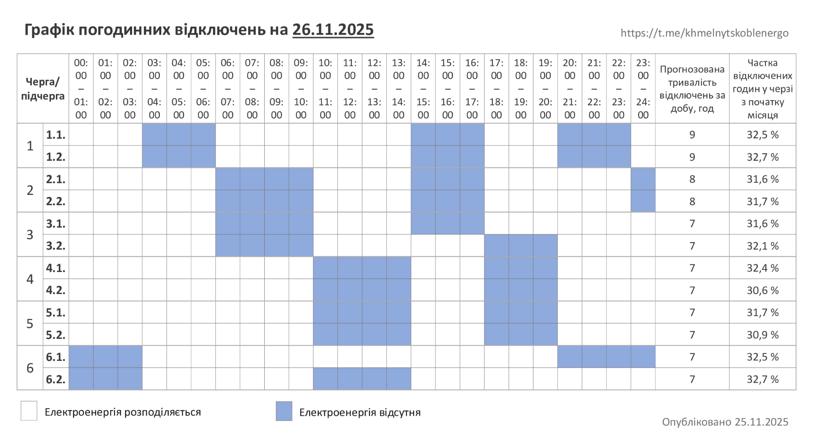

# ⚡ Як користуватися ботом

Бот стежить за погодинними відключеннями світла на сайті [Хмельницькобленерго](https://hoe.com.ua) і пише вам,
щойно для вашої адреси щось змінилось. Перевіряти сайт самостійно більше не треба.

> ℹ️ Неофіційний проєкт, не пов'язаний з Хмельницькобленерго. Дані можуть відставати від офіційних — для важливих
> рішень звіряйтесь із сайтом.

Як розгорнути власного бота — див. [інструкцію для адміністраторів](ADMIN.md).

- [Перші кроки](#перші-кроки)
- [Команди](#команди)
- [Як додати адресу](#як-додати-адресу)
- [Фільтр за чергою](#фільтр-за-чергою)
- [Черга з особистого кабінету](#черга-з-особистого-кабінету)
- [Графік відключень](#графік-відключень)
- [Сповіщення в канал або групу](#сповіщення-в-канал-або-групу)
- [Slack](#slack)
- [Поширені питання](#поширені-питання)

## Перші кроки

1. Відкрийте бота в Telegram і надішліть `/add`.
2. Оберіть населений пункт, вулицю, введіть номер будинку.
3. Вкажіть свою чергу — вручну або через [особистий кабінет](#черга-з-особистого-кабінету).

Готово: бот надішле поточний стан і далі писатиме лише тоді, коли щось зміниться. Приклад сповіщення:

```
Змінились погодинні відключення!
📍 Давидківці, вул. Подільська, 1 · черга 2.1

Вид робіт: Планові
Тип відключення: Відключення
Черга ГПВ: 2.1
Початок: 26.11.2025 14:00
Кінець: 26.11.2025 18:00
```

## Команди

| Команда | Що робить |
|---|---|
| `/add [населений пункт]` | Додати адресу: населений пункт → вулиця → будинок → черга. `/add Давидківці` одразу шукає цей пункт; у приватному чаті є кнопка з останнім обраним |
| `/add … --queue=1.1` | Те саме, з одразу вказаною чергою |
| `/add … --to=<ID або @канал>` | Сповіщення йтимуть у канал чи групу ([докладніше](#сповіщення-в-канал-або-групу)) |
| `/add … --slack=<ID або #канал>` | Сповіщення в канал Slack від вашого Slack-бота ([докладніше](#slack)) |
| `/list` | Мої адреси; кнопки: відключення ✅/⬜, графік ✅/⬜, звук 🔔/🔕, черга 🔢, видалити 🗑 |
| `/check` | Перевірити всі мої адреси зараз |
| `/graph [all]` | Актуальний графік — картинка та/або текст. Якщо вказано чергу — текст лише для неї, `all` — повністю |
| `/cabinet` | Особистий кабінет: статус, оновити чергу, змінити пароль, видалити дані ([докладніше](#черга-з-особистого-кабінету)) |
| `/slack` | Підключити власного Slack-бота, переглянути й видалити ботів ([докладніше](#slack)) |
| `/cancel` | Скасувати поточну дію |
| `/help` | Довідка |

У груповому чаті змінювати адреси можуть лише адміністратори групи.

## Як додати адресу

`/add` веде по кроках: населений пункт → вулиця → будинок. Можна вводити частину назви.

Номер будинку звіряється зі списком сайту: регістр не важливий, латиниця й кирилиця вважаються однаковими
(`12a` = `12А`), зберігається написання з сайту. Якщо будинку немає, бот пропонує схожі (`12` → `12А`, `12/1`) або
кнопку «Все одно додати». Якщо пошук на сайті тимчасово недоступний — спробуйте пізніше.

Після будинку (у приватному чаті) бот питає, **як визначити чергу**:

- `🔐 З особистого кабінету` — бот візьме чергу з вашого договору ([докладніше](#черга-з-особистого-кабінету));
- `✋ Вкажу сам` — оберете кнопкою (1.1 … 6.2);
- `⏭ Без черги` — отримуватимете все, що сайт показує для адреси.

Кожну адресу потім можна налаштувати в `/list`: сповіщення про відключення, графік, звук, черга, видалення.

> Для досвідчених: `/add_id <streetId> <будинок> [назва]` (приймає ті самі `--queue`, `--to`, `--slack`).

## Фільтр за чергою

Кожна адреса може мати **свою підчергу ГПВ** (`1.1` … `6.2`). Тоді бот надсилає лише те, що її стосується:

- **Як вказати:** кнопка «🔢 Черга» в `/list` (і під повідомленням «Додано»), `--queue=1.1` у `/add` або
  [особистий кабінет](#черга-з-особистого-кабінету). Змінити чи зняти фільтр («Усі черги») можна будь-коли.
- **Відключення за адресою:** лишаються записи вашої черги. Черга без підчерги (`2`) вважається збігом для `2.1` і `2.2`.
  Записи без ГПВ-черги (наприклад, лише аварійні — ГАВ) показуються завжди. Повідомлення надходить, лише коли змінилось
  те, що стосується вашої черги, — зміни в чужих чергах не турбують.
- **Текстовий графік:** ви отримуєте лише рядки `Підчерга …` своїх черг. Якщо в чаті кілька адрес із різними чергами —
  отримаєте їх об'єднання; якщо хоч одна адреса без черги — повний графік. `/graph all` завжди показує повний.
- Картинка-графік не фільтрується (це зображення).

## Черга з особистого кабінету

Якщо у вас є акаунт в [особистому кабінеті](https://cabinet.hoe.com.ua) Хмельницькобленерго, бот може взяти точну
чергу з вашого договору й **оновлювати її сам**. Якщо будинок переведуть в іншу чергу, ви отримаєте повідомлення
«Змінилась черга відключень: нова черга 3.1 (була 2.2)», а фільтр перемкнеться автоматично.

> Функція доступна, якщо її ввімкнув адміністратор бота. Інакше `/cabinet` так і скаже.

**Як підключити** (лише в приватному чаті з ботом):

- під час `/add` — кнопка `🔐 З особистого кабінету`;
- для вже доданої адреси — `/list` → «🔢 Черга» → «🔐 Взяти з особистого кабінету».

Бот попросить логін (email або телефон) і пароль від кабінету. **Повідомлення з паролем він одразу видаляє з чату.**
Далі:

- якщо в кабінеті кілька договорів — оберете потрібний;
- якщо адреса в кабінеті відрізняється від доданої (інший будинок чи вулиця) — бот попередить і спитає, чи брати чергу;
- для наступних адрес пароль уводити не треба — бот запропонує збережений акаунт (`🔐 us***@gmail.com`);
- якщо кабінет тимчасово недоступний — адресу все одно буде додано, а чергу оберете вручну.

Адреси з чергою з кабінету позначені 🔐 у `/list`. Якщо вручну обрати іншу чергу, автооновлення для цієї адреси
вимикається.

**`/cabinet`** показує ваші акаунти, прив'язані адреси та їхні черги:

- «🔄» — оновити черги зараз;
- «🔑 Пароль» — вказати новий пароль (наприклад, якщо ви змінили його на сайті — бот сам про це напише);
- «🗑 Видалити» — стерти логін, пароль і токен. Адреси лишаться з останньою чергою, але вона більше не оновлюватиметься.

**Про ваш пароль.** Бот зберігає його, щоб щодня самостійно входити в кабінет (вхід діє лише добу). Пароль
зберігається зашифрованим, але адміністратор сервера, на якому працює бот, технічно може його розшифрувати. Якщо вам
це не підходить — оберіть чергу вручну. Видалити дані можна будь-коли в `/cabinet`.

## Графік відключень

Хмельницькобленерго публікує графік погодинних відключень **то картинкою, то текстом** (інколи обома способами).
Бот розуміє обидва формати.

- Кнопка **«Графік»** в `/list` вмикає надсилання графіка, щойно він змінився на сайті. Той самий графік двічі не
  надсилається.
- `/graph` показує актуальний графік будь-коли — незалежно від підписки.

Текстовий графік виглядає так:

```
Графік погодинних відключень

За розпорядженням НЕК «Укренерго» 07 листопада на Хмельниччині будуть застосовані графіки погодинних відключень (ГПВ):

Підчерга 1.1 – 00:00-04:00; 09:00-13:00; 18:00-21:00.
Підчерга 1.2 – 00:00-04:00; 09:00-13:00; 18:00-21:00.
...
```

А так — картинка:

<p align="center"></p>

## Сповіщення в канал або групу

**Група.** Додайте бота в групу й надішліть там `/add`. У групі бот бачить лише команди та відповіді на свої
повідомлення, тож у діалозі відповідайте (Reply) на його запитання. Керувати адресами групи можуть її адміністратори.

**Канал.**

1. Додайте бота в канал **адміністратором** з правом «Публікація повідомлень».
2. У **приватному чаті з ботом** (не в каналі) надішліть команду з параметром `--to`:
   ```
   /add --to=-1001234567890
   /add Давидківці --to=@my_channel
   ```
   `--to` приймає числовий ID (`-100…`) або @username публічного каналу. ID приватного каналу можна дізнатись,
   переславши пост у [@userinfobot](https://t.me/userinfobot). На телефоні `--` часто замінюється на «—» — це теж працює.
3. Бот перевірить, що може писати в канал і що **ви** — його адміністратор, і надішле туди поточний стан.
4. Керувати такими адресами можна з `/list` у приватному чаті (підпис «➡️ Куди»), поки ви лишаєтесь адміністратором
   каналу.

## Slack

Сповіщення можна отримувати й у Slack — від вашого власного Slack-бота.

1. У боті надішліть `/slack` → «➕ Підключити Slack-бота» (інструкція всередині). Коротко: на api.slack.com/apps
   створіть застосунок, у **OAuth & Permissions** додайте права `chat:write` і `files:write` (для пошуку каналів за
   назвою — ще `channels:read`, `groups:read`), натисніть **Install to Workspace** і скопіюйте **Bot User OAuth Token**
   (`xoxb-…`).
2. Надішліть токен боту в **приватному** чаті. Повідомлення з токеном бот одразу видаляє, перевіряє токен і зберігає
   його зашифрованим. У списках показується лише кінець (`xoxb-…AbCd`).
3. Запросіть Slack-бота в канал: `/invite @назва_бота`.
4. Додайте адресу з параметром `--slack`:

```
/add --slack=C0123ABCD
/add Давидківці --slack=#svitlo --queue=1.1
/add --slack=2:C0123ABCD                 # якщо ботів кілька — №бота з /slack
```

- Канал можна вказати **ID** (`C0123ABCD`: у Slack відкрийте канал → назва вгорі → внизу «ID каналу») або **#назвою**.
- Одразу після додавання бот надсилає в канал перше повідомлення — так перевіряється, що все працює. Якщо ні, адресу не
  додано, а бот підкаже виконати `/invite`.
- `/slack` показує ваших ботів і кількість підписок; «🗑» видаляє бота **разом з усіма його підписками**. Ліміт — 3 боти.
- Адреси в Slack налаштовуються з приватного чату в `/list` так само, як для Telegram. Звук у Slack не застосовується.
- Якщо бота вилучили з каналу або відкликали токен — підписки цього каналу прибираються автоматично.

## Поширені питання

<details>
<summary><b>Бот не відповідає в групі</b></summary>

У групі бот бачить лише команди й відповіді на свої повідомлення. Відповідайте (Reply) на повідомлення бота під час
діалогу `/add`.
</details>

<details>
<summary><b>У канал нічого не приходить</b></summary>

Перевірте, що бот — адміністратор каналу з правом «Публікація повідомлень», а ID вказано з мінусом (`-100…`).
Команду `/add … --to=…` треба надсилати боту в приватні повідомлення, а не в канал.
</details>

<details>
<summary><b>Як дізнатися свою чергу?</b></summary>

Найпростіше — підключити [особистий кабінет](#черга-з-особистого-кабінету): бот візьме чергу з договору. Інакше
чергу видно на сайті hoe.com.ua у результатах пошуку відключень за адресою (рядок «Черга ГПВ»).
</details>

<details>
<summary><b>Бот пише, що пароль від кабінету не підходить</b></summary>

Ви, мабуть, змінили пароль на сайті. Відкрийте `/cabinet` → «🔑 Пароль» і введіть новий. Доки цього не зроблено,
черга не оновлюється (лишається остання відома).
</details>

<details>
<summary><b>Чому сповіщення прийшло із запізненням?</b></summary>

Бот перевіряє сайт раз на кілька хвилин (інтервал задає адміністратор, типово 15 хв). Крім того, дані на сайті
можуть оновлюватися пізніше за офіційні оголошення.
</details>